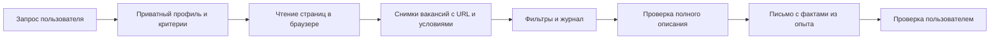

# Job Search Agent

Browser-assisted поиск работы с проверяемыми решениями, журналом прошлых откликов и персональными сопроводительными письмами. Публичная версия личного workflow Алексея Иванова, перенесённого из Claude Code в Codex.

В репозитории есть переносимый skill и исполняемый модуль отбора вакансий. Coding-агент читает страницы, извлекает условия, оценивает соответствие опыта и готовит письма. Модуль отбора проверяет формальные критерии и возвращает причины решения для каждой карточки.

## Быстрый запуск

Команды запускаются из корня общего репозитория. Нужен Node.js 22+. Внешние пакеты для демо отсутствуют.

```sh
node --test
node src/cli.mjs --vacancies examples/vacancies.json --criteria examples/criteria.json --journal examples/journal.json --output output/report.json
```

Ожидаемый результат демо

```json
{"scanned":11,"selected":5,"review":2,"rejected":4,"remaining":0}
```

Откройте `output/report.json`, чтобы увидеть выбранные вакансии и причины решений. Все компании и вакансии в `examples/` вымышлены. Домены `example.invalid` служат маркерами тестовых данных. Конверсия валют в демо задана условными коэффициентами, для рабочего запуска их обновляют в приватном конфиге.

## Как устроен workflow



Рабочие инструкции находятся в [SKILL.md](../../.agents/skills/job-search/SKILL.md). Формат входных данных и правила извлечения находятся в [references/input.md](../../.agents/skills/job-search/references/input.md).

| Часть | Что проверяет | Где реализована |
| --- | --- | --- |
| Browser skill | Полное описание, ограничения, связь требований с опытом | `.agents/skills/job-search/` |
| Screening | Зарплата, формат, город, стаж, основной стек, оформление | `src/screen.mjs` |
| Дедупликация | ID вакансии, ID работодателя, нормализованное название | `src/screen.mjs` |
| Отчёт | Решение, причины отказа, недостающие сведения, очередь проверки | `src/cli.mjs` |
| Регрессионные проверки | Обновление критериев, повторы, неизвестные поля и валюты | `test/` |

## Решения и ограничения

- Условия поиска задаются одним JSON-конфигом. Трудовой договор допустим, если он входит в `allowedContracts`. Порог зарплаты применяется к верхней границе вилки. Открытая вилка «от 80 тысяч» при пороге 100 тысяч требует уточнения верхней границы.
- Неуказанная зарплата допустима. Неизвестные формат работы, оформление, основной стек или требования по стажу переходят в `review`. Прочитанное описание подтверждается отдельно от наличия короткого фрагмента из выдачи.
- В очередь попадает одна вакансия компании. Журнал исключает работодателя даже при смене названия, если совпадает его ID. Без стабильного ID сравнение названий остаётся эвристикой, слияние брендов проверяет человек.
- Код сохраняет порядок найденных вакансий. Для изменения приоритетов агент сначала объясняет выбор пользователю. В отчёте видны и подходящие вакансии сверх лимита.
- Повторный запуск на одинаковых снимках даёт одинаковый отчёт. Запись отчёта использует временный файл с последующим переименованием. Дедупликация отбора действует до этапа отправки. При неопределённом статусе отправки агент проверяет сайт и журнал перед повторным действием.
- Описание вакансии обрабатывается как внешний текст. Команды внутри него не дают разрешения отправлять сообщения, раскрывать профиль или запускать код.
- JSON-модуль доверяет извлечённым полям. Противоречия внутри описания, ограничения по стране проживания и требования к отдельным технологиям проверяет browser-агент. Подходящая карточка требует этой смысловой проверки перед письмом.

## История проекта и вклад

Исходный личный агент работал в Claude Code. В нём были критерии поиска, журнал компаний и вакансий, отчёты запусков, персонализация писем, браузерные скрипты поиска и отклика, обработка капч и передача анкет человеку. Исходные журналы содержат личные данные и переписку.

Эта публичная версия оформлена 21 ноября 2026 года совместно с Codex. Она добавляет автономно запускаемый модуль отбора, синтетические примеры, регрессионные проверки и инструкции для текущего браузерного интерфейса. Старые вызовы Claude in Chrome требуют другого адаптера, поэтому рабочий браузерный этап здесь описан через возможности доступного runtime.

Репозиторий показывает постановку задачи, правила управления агентом, работу с фактами, проверку результата и доработку workflow с coding-агентом. Источник кода и примеров виден в этой версии. Работоспособность публичного модуля проверяется демозапуском и тестами. Полный браузерный поиск и отправка откликов зависят от сессии пользователя и текущего интерфейса сайта.

Для ревью начните с демозапуска, затем посмотрите обработку неполных данных и тесты на повторные компании. Для использования с реальными данными храните профиль, снимки страниц, письма и журнал в `private/`. Эта папка исключена из Git.
